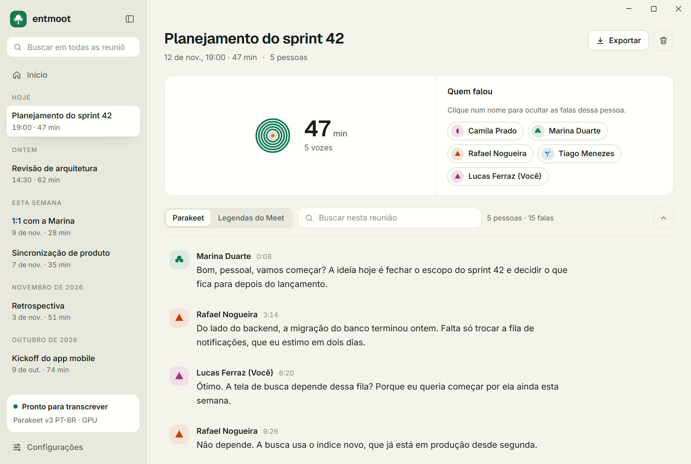
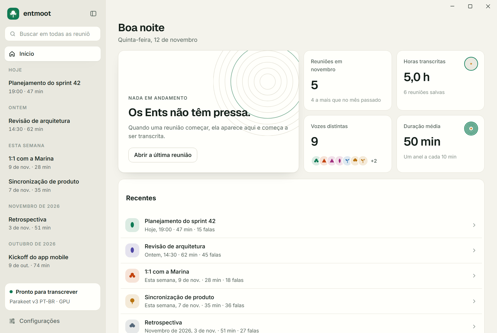
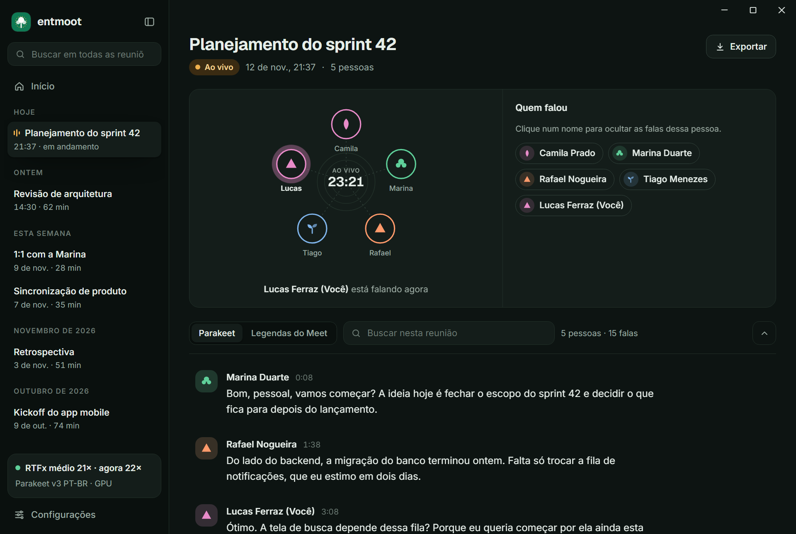
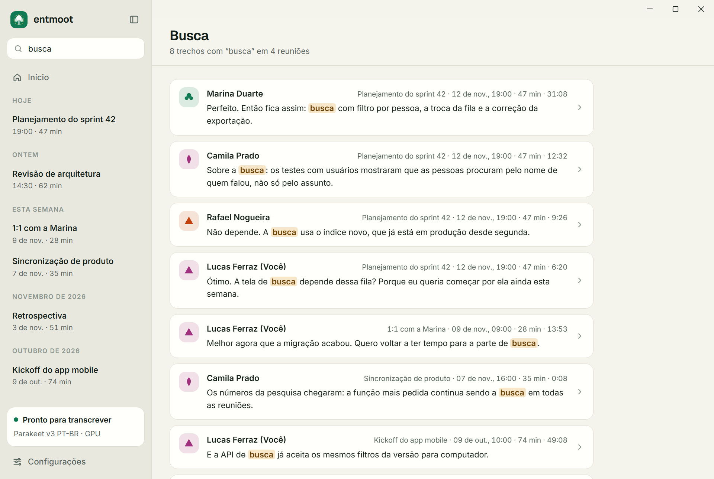
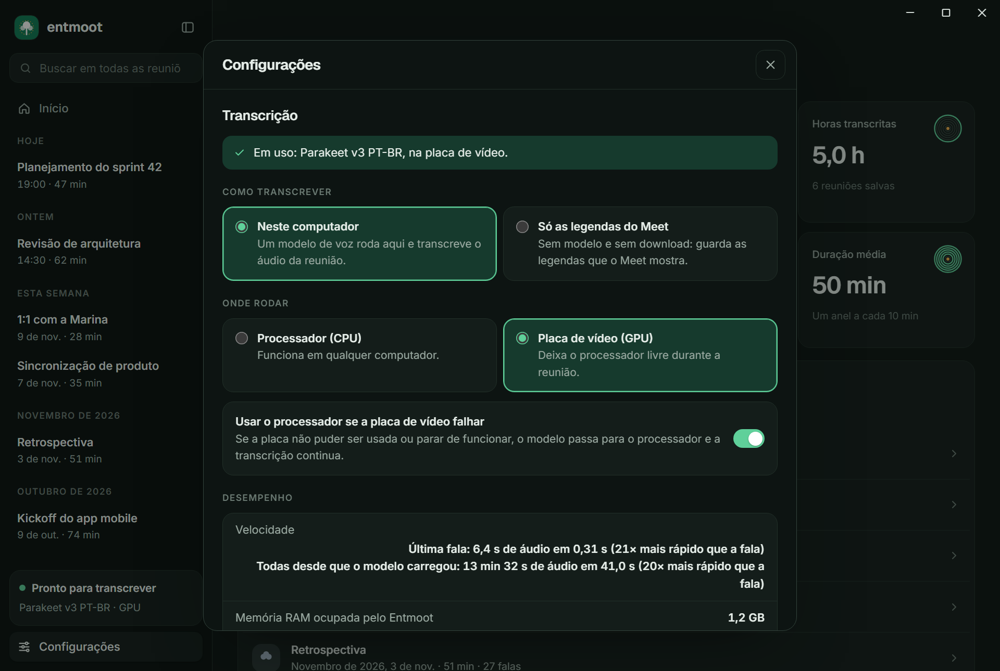
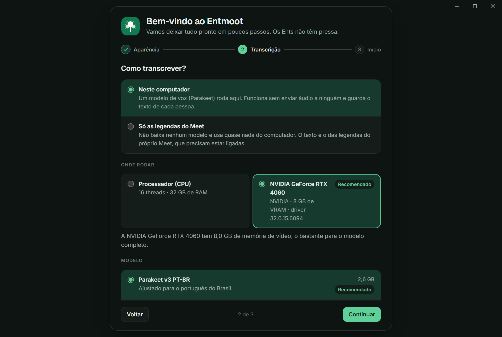

# entmoot

Transcrição de reuniões do Google Meet e do Microsoft Teams feita no seu computador.

O entmoot é um aplicativo para Windows que acompanha uma extensão de navegador (Zen ou Firefox). A extensão captura o áudio direto da chamada; o aplicativo transcreve com um modelo de fala local (Parakeet v3) e guarda tudo num banco SQLite. Nenhum áudio ou texto sai da máquina.



## O que ele faz

- **Transcreve enquanto a reunião acontece.** O texto aparece na tela poucos segundos depois de cada fala, sem robô entrando na chamada e sem que os outros participantes vejam nada.
- **Roda no seu computador.** O modelo de fala usa a GPU, se houver uma, ou a CPU. Não precisa de conta em serviço nenhum.
- **Guarda as legendas da plataforma.** As legendas do Meet e do Teams ficam salvas ao lado da transcrição. Num computador modesto, dá para dispensar o modelo e ficar só com elas.
- **Busca em todas as reuniões.** Uma palavra ou frase encontra o trecho, quem disse e em qual reunião.
- **Fica fora do caminho.** Pode iniciar com o Windows e ficar na bandeja; a reunião começa a ser gravada sozinha quando você entra na chamada e você pode consultar depois.


## Telas

| | |
|---|---|
|  **Início**: o que está acontecendo e os números do mês. |  **Ao vivo**: quem está falando, o relógio e a velocidade da transcrição. |
|  **Busca** em todas as reuniões. |  **Configurações**: modelo, onde rodar e desempenho. |

## Instalação

Você precisa de:

- Windows 10 ou 11
- Um navegador baseado no Firefox (o próprio Firefox, Zen ou outro)

### 1. Extensão

1. Baixe `entmoot.xpi` na mesma [página de versões](../../releases/latest).
2. Abra a extensão com o navegador ou arraste o arquivo para dentro dele. Confirme a instalação e as permissões solicitadas.
3. O botão do entmoot na barra do navegador abre um menu com algumas escolhas para cada plataforma: se as reuniões dali são transcritas e se a extensão liga as legendas sozinha. Depois de mudar algo, recarregue a aba da reunião.

### 2. Aplicativo

Baixe o instalador na [página de versões](../../releases/latest) e execute.

### 3. Configuração inicial

Ao abrir pela primeira vez, o entmoot faz três perguntas antes de baixar qualquer coisa:

**Transcrição**: Você pode escolher se quer usar um modelo neste computador, ou só guardando as legendas da própria reunião. Para o modelo local, você pode escolher se quer rodar na GPU (caso disponível) ou na CPU e o modelo que deseja usar.

Ao concluir, o modelo escolhido começa a ser baixado e o andamento aparece na barra lateral. Quando ela mostrar "Pronto", está tudo certo: o modelo só é carregado na memória quando você abre uma reunião no navegador, e sai dela 5 minutos depois que a reunião termina. Todas essas escolhas podem ser mudadas depois em **Configurações**.



### 4. Primeira reunião

Com o entmoot aberto (ele pode ficar na bandeja), entre numa reunião do Meet ou do Teams pelo navegador. A reunião aparece na lista assim que a chamada começa e o texto vai surgindo enquanto as pessoas falam. Enquanto a barra lateral mostrar "Aguardando a extensão", o navegador ainda não se conectou ao app.

No Meet, a extensão pede as legendas ao entrar, sem que nada apareça na tela. No Teams, as legendas só existem se alguém na reunião as ligar. A extensão pode fazer isso clicando no botão de legendas da página (o painel de legendas aparece na tela), mas essa opção vem desligada e ainda é experimental.

## Modelos

| Nome | O que é | Tamanho | Onde roda |
|---|---|---|---|
| `parakeet-v3-ptbr` | Parakeet TDT 0.6B v3 ajustado para o português do Brasil (padrão) | 2,6 GB | GPU/CPU |
| `parakeet-v3` | O original multilíngue, 25 idiomas | 2,6 GB | GPU/CPU |
| `parakeet-v3-int8` | O multilíngue quantizado em 8 bits | 670 MB | CPU |

Os arquivos vêm de revisões fixas no Hugging Face, listadas em `app/core/src/models.rs`.

## Onde ficam os dados

O aplicativo instalado guarda tudo em `%APPDATA%\entmoot`:

| Item | Conteúdo |
|---|---|
| `entmoot.db` | Reuniões, transcrições e legendas |
| `settings.json` | Preferências |
| `models\` | Modelos baixados |
| `diagnostics\` | O que a extensão enviou nas últimas conexões, sem o áudio |
| `recordings\` | Só no modo de desenvolvedor: uma pasta por reunião com as mensagens da extensão, o áudio e a transcrição |

### Modo de desenvolvedor

Para investigar um problema ou gravar uma reunião para os testes, aperte **F12** dentro do app e confirme. Aparece uma seção "Desenvolvedor" nas configurações, onde você escolhe o que guardar: o dump completo das mensagens da extensão, o áudio e as transcrições. Cada reunião vira uma pasta em `recordings\`, no formato que `transcritor replay` e `tools/replay/` leem. Não precisa instalar outra extensão nem rodar nada à parte.

## Compilando a partir do código

Esta parte é para quem quer modificar o entmoot. Para só usar, a [instalação](#instalação) acima basta.

Além do Windows e do navegador, você precisa de:

- [Rust](https://rustup.rs) estável
- Node.js 20 ou mais novo
- Para os scripts em `tools/`: [uv](https://docs.astral.sh/uv/)

### Estrutura

| Pasta | Conteúdo |
|---|---|
| `app/core/` | Núcleo em Rust: servidor WebSocket, VAD, inferência, banco, exportação. Também é um programa de linha de comando. |
| `app/desktop/` | Aplicativo Tauri 2. `src/` é a interface em React e TypeScript; `src-tauri/` é o lado Rust da janela. |
| `extension/` | Extensão Manifest V3 para Zen e Firefox 142 ou mais novo. |
| `tools/replay/` | Reprodução de sessões gravadas e testes da extensão fora do navegador. |
| `tools/spike-receiver/` | Receptor que grava em disco tudo que a extensão envia. |
| `docs/` | Notas de viabilidade e as imagens deste README. |

### Aplicativo

```powershell
cd app\desktop
npm install
npm run tauri dev      # desenvolvimento, com recarga da interface
npm run tauri build    # instalador em src-tauri\target\release\bundle\nsis\
```

### Extensão

Durante o desenvolvimento, carregue a pasta direto: abra `about:debugging#/runtime/this-firefox`, clique em **Carregar extensão temporária** e escolha `extension\manifest.json`. Depois de cada mudança, clique em **Recarregar** ali e recarregue a aba da reunião.

Para gerar o pacote `.xpi` que pode ser instalado, rode:

```powershell
powershell -ExecutionPolicy Bypass -File extension\build.ps1   # gera extension\dist\entmoot.xpi
```

## Limitações

- Só o Google Meet e o Microsoft Teams no navegador, só em navegadores baseados no Firefox, e o aplicativo só para Windows.
- O Teams não envia as faixas de áudio separadas por falante, como o Meet faz. Por isso, quando duas pessoas falam ao mesmo tempo algumas palavras podem se misturar na transcrição.
- Uma reunião por vez.
- A extensão depende de detalhes internos do Meet e do Teams, que podem mudar a qualquer momento.

## Créditos

- Essa solução foi inspirada em apps como [Granola](https://www.granola.ai/), [Meetily](https://github.com/Zackriya-Solutions/meetily), [Parley](https://github.com/Hankanman/Parley), [Scribbl](https://scribbl.co/) e outros, vale conferir cada um deles.
- Modelos: [Parakeet TDT 0.6B v3](https://huggingface.co/nvidia/parakeet-tdt-0.6b-v3) da NVIDIA, nas conversões para ONNX de [istupakov](https://huggingface.co/istupakov/parakeet-tdt-0.6b-v3-onnx) e no ajuste para português de [alexandreacff](https://huggingface.co/alexandreacff/parakeet-tdt-tagarela-v2) e [alefiury](https://huggingface.co/alefiury/parakeet-tdt-0.6b-v3-ptBR-TAGARELA-onnx).
